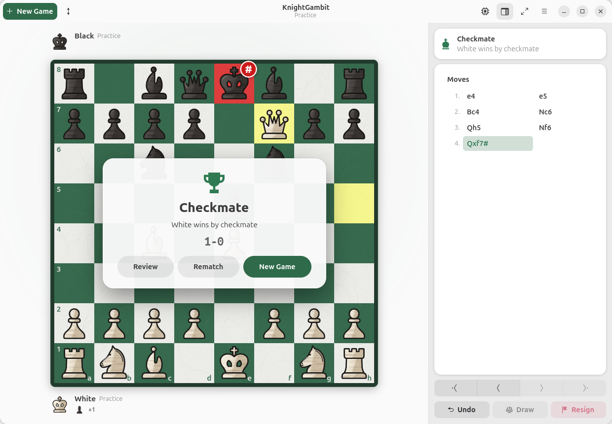
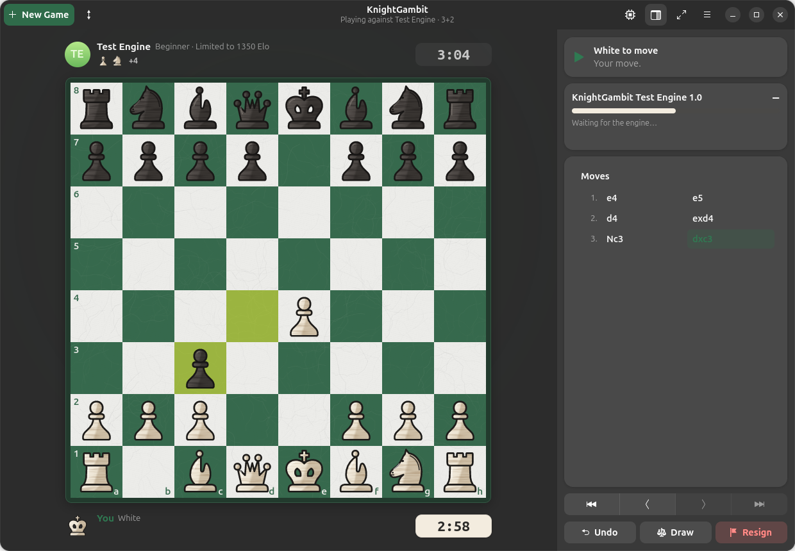
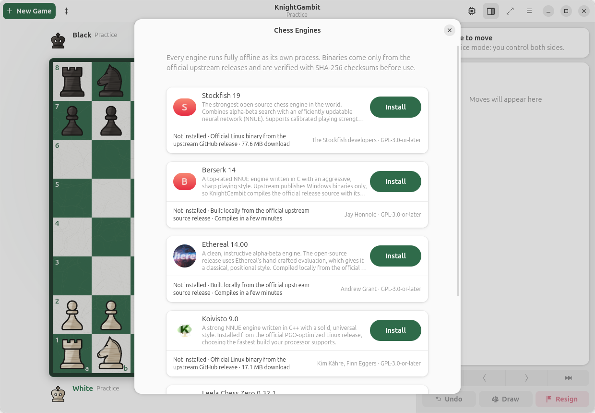
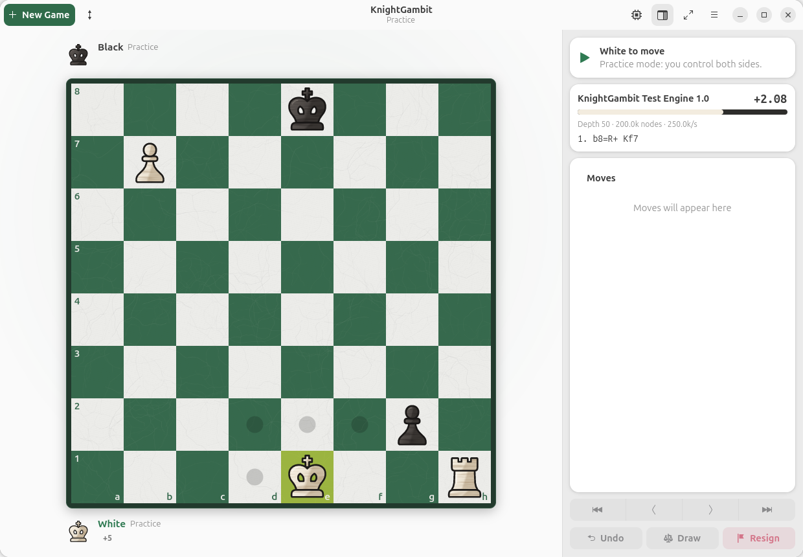
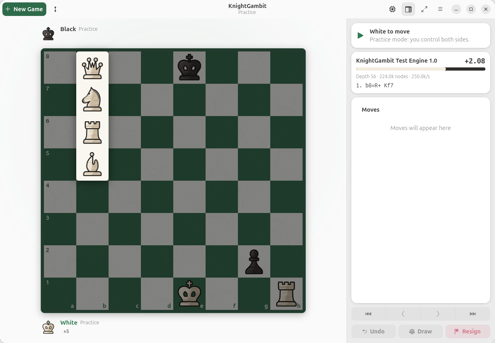
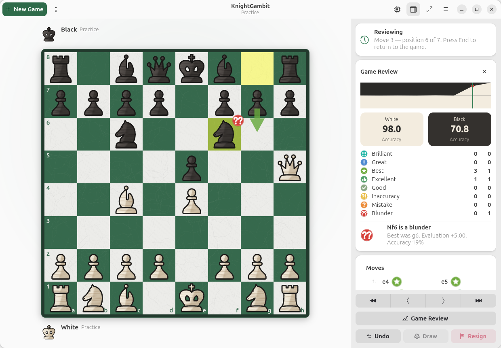
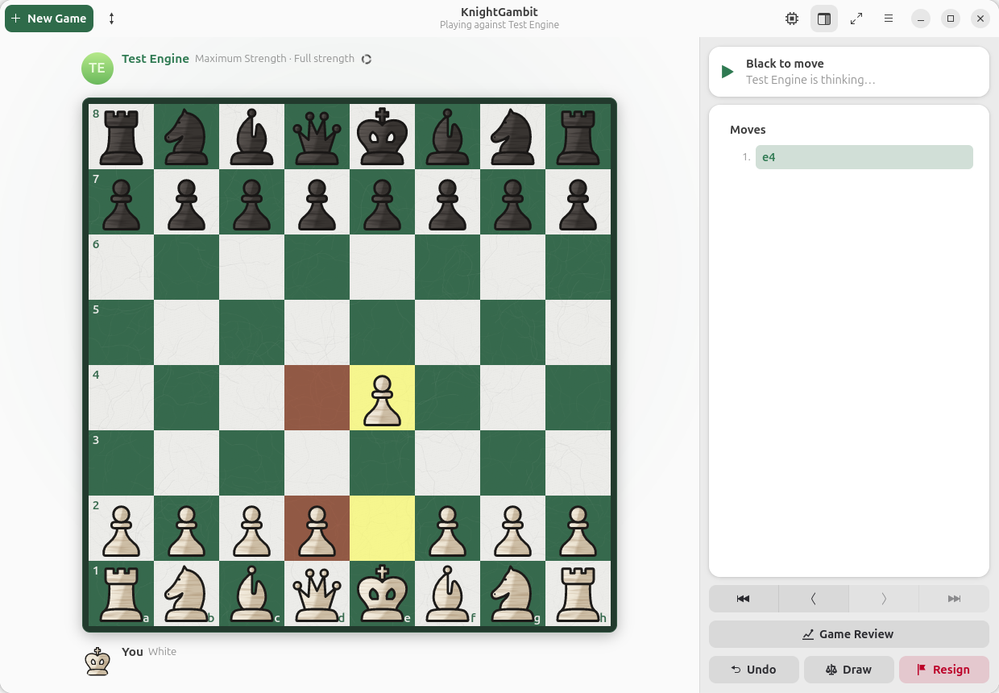

# KnightGambit

**Think. Play. Master.**

KnightGambit is a premium, fully offline chess application for Ubuntu and the GNOME desktop. It is written in
Rust with GTK 4 and libadwaita, renders original Staunton-inspired vector pieces on a forest green and ivory board,
implements the complete official rules of chess, and plays against genuine open-source UCI engines.



| | |
| --- | --- |
|  |  |
|  |  |
|  |  |

## Features

- **Board and pieces**: original vector pieces in three styles (Ivory and Charcoal Wood, Walnut and Maple,
  Classic Flat), plus a **Custom Folder** style that loads your own SVG piece set (`wK.svg`, `wQ.svg` …
  `bP.svg`, also `white_king.svg` naming), rendered off the main thread at the exact device-pixel size so they stay sharp on high-DPI and
  fractional-scaling displays. The board has a subtle leather-grain texture, a framed border and coordinates
  inside the squares or on the frame. It comes with five presets (Forest Green and Ivory, Traditional Brown and
  Cream, Tournament Green, Blue and White, Charcoal and Light Gray) and fully custom square colors.
- **Interaction**: drag and drop, click-to-move, legal-move dots and capture rings, last-move and check
  highlighting, a promotion picker, and castling by moving the king two squares or onto its rook. Moves animate
  smoothly (including castling, en passant and capture fades) with adjustable speed or no animation.
- **Rules**: complete legal move generation (via `shakmaty`), check, checkmate, stalemate, castling rights,
  en passant, promotion and insufficient material. Threefold repetition and the fifty-move rule are claimable;
  fivefold repetition, the seventy-five-move rule (unless the last move mates) and dead positions end the game
  automatically. Running out of time against a lone king (insufficient mating material) is a draw.
- **Game Review**: after any game (or an imported PGN), **Stockfish** analyzes every position at full strength
  (all allowed threads and hash, two principal variations), no matter which engine you played. Each move is
  classified as Brilliant, Great, Book, Best, Excellent, Good, Forced (the only legal move), Inaccuracy,
  Mistake, Miss (failing to punish the opponent's mistake or blunder) or Blunder. Classifications use the
  larger of the win-probability drop and the material (centipawn) loss against Stockfish's best move, so pieces
  thrown away are penalized even in already lost positions; Brilliant marks a sound piece sacrifice, Great marks the
  only good move, and Book marks opening theory from a built-in offline book of more than 200 main lines,
  which also names the opening. Moves are colored by class in the move list with a badge next to notable
  ones, the board shows the badge and a sky-blue arrow for the best alternative, and the summary shows each
  player's accuracy (harmonic and volatility-weighted average, so a few blunders cannot hide behind many easy
  moves), an estimated game rating (Elo) derived from accuracy and blunder rate, colored
  per-class counts and a clickable evaluation graph. Review depth is configurable (Fast, Standard, Deep).
- **Live analysis**: in practice mode and after a game, Stockfish evaluates the position you are viewing at
  full strength and shows the evaluation, depth and best line. Opponent engines are never used for analysis.
- **Premoves**: while the engine is thinking, drag or click your next move. It is highlighted in red and
  played the instant the engine replies, if it is still legal. Right-click or Escape cancels it. Premoves can
  be turned off in Preferences → Gameplay.
- **Checkmate presentation**: the mated king's square turns red, an animated `#` badge pops in, a result card
  names the winner, the clock stops and the board locks, with New Game, Rematch and Review buttons.
- **Engines**: Stockfish 19, Berserk 14, Ethereal 14.00, Koivisto 9.0 and Leela Chess Zero 0.32.1, plus any
  custom UCI executable. Each engine runs as its own process with asynchronous communication. The process is
  reused across games, searches are stopped when positions change, and crashes are reported without freezing
  the interface.
- **Difficulty**: Beginner (about 1350 Elo), Intermediate (about 1800), Advanced (about 2300), Maximum, and
  Custom (Elo, depth limit, thinking time). KnightGambit uses `UCI_Elo`, then `Skill Level`, then node or depth
  limits, depending on what each engine supports.
- **Game modes**: play the computer as White, Black or a random color, local two-player games, and practice
  mode (you move both sides, with optional live engine analysis).
- **Clocks**: bullet (1+0, 2+1), blitz (3+0, 3+2, 5+0, 5+3), rapid (10+0, 10+5, 15+10), classical (30+0,
  30+20, 60+0, 90+30), or custom time with Fischer increment, simple (US) delay or Bronstein delay, or no clock.
- **Review**: a SAN move list (standard, figurine or long algebraic), first/previous/next/last navigation,
  captured pieces with material balance, takeback, resign, draw offers, draw claims, and post-game engine
  analysis.
- **Files**: PGN import and export (including games from custom positions), FEN loading and copying, and
  opening `.pgn` files from the file manager.
- **Desktop integration**: light, dark and system theme, a resizable sidebar (drag its left edge; the width is
  remembered), an adaptive layout that collapses the sidebar on narrow windows, fullscreen with a maximized board, keyboard shortcuts, synthesized wooden sound effects, and settings
  persisted between sessions.

## Requirements

- Ubuntu 24.04 LTS or newer (GTK 4.14+, libadwaita 1.5+), Wayland or X11
- To build: Rust 1.85+ (install with [rustup](https://rustup.rs)), `pkg-config`, and the GTK development packages

```bash
sudo apt install build-essential pkg-config libgtk-4-dev libadwaita-1-dev
```

Sound effects play through PipeWire (`pw-play`), PulseAudio (`paplay`) or ALSA (`aplay`), whichever is
installed. Ubuntu desktops include `pw-play` by default.

## Build and run

```bash
cargo run --release
```

## Install

### Debian package (recommended)

```bash
make deb
sudo apt install ./dist/knightgambit_1.0.4_amd64.deb
```

KnightGambit then appears in the GNOME application grid with its icon and desktop entry.
To remove it, run `sudo apt remove knightgambit`.

### Manual install

```bash
make install PREFIX=$HOME/.local
make uninstall PREFIX=$HOME/.local
```

Use `sudo make install` to install system-wide into `/usr/local`.

## Chess engines

Open **Engines** (Ctrl+E). Nothing is bundled and nothing is downloaded until you click **Install**.

| Engine | How KnightGambit installs it | Extra requirements |
| --- | --- | --- |
| Stockfish 19 | Official Linux release binary (78 MB), SHA-256 verified | none |
| Koivisto 9.0 | Official PGO binary for AVX2, SSE4.2 or SSE2, chosen automatically, SHA-256 verified | none |
| Berserk 14 | Official source and network, compiled locally (upstream ships Windows binaries only) | `sudo apt install make gcc` |
| Ethereal 14.00 | Official source, compiled locally (no upstream binaries) | `sudo apt install make gcc` |
| Leela Chess Zero 0.32.1 | Official source, compiled locally with Meson | `sudo apt install meson ninja-build g++ python3 libopenblas-dev zlib1g-dev` |

- Leela Chess Zero needs a neural network. On its configuration page you can download the recommended small,
  CPU-friendly network (37 MB, from storage.lczero.org) or choose any `.pb.gz` file.
- Engines already installed on the system (for example `sudo apt install stockfish`) are detected
  automatically and can be used with **Use System Copy**.
- **Add Engine Executable…** accepts any UCI engine. KnightGambit verifies the UCI handshake first.
- Each engine has its own threads, hash and UCI option settings. Preferences → Engines sets global CPU-thread
  and memory caps that always apply.

Installed engines live in `~/.local/share/knightgambit/engines/`. Uninstalling an engine from the manager
deletes its files.

## Keyboard shortcuts

| Action | Shortcut |
| --- | --- |
| New game / restart | Ctrl+N / Ctrl+R |
| Game review | Ctrl+Shift+R |
| Take back | Ctrl+Z |
| Previous / next move | Left / Right |
| First / current position | Home / End |
| Flip board | Ctrl+F |
| Fullscreen / sidebar | F11 / F9 |
| Open / save PGN | Ctrl+O / Ctrl+S |
| Copy FEN / copy PGN | Ctrl+Shift+C / Ctrl+Alt+C |
| Load FEN | Ctrl+L |
| Engines / preferences | Ctrl+E / Ctrl+, |
| Shortcuts / quit | Ctrl+? / Ctrl+Q |

## Testing

```bash
cargo test
```

The test suites cover:

- `tests/chess_rules.rs`: perft on the standard start position, Kiwipete and positions 3 and 4 (the standard
  move-generator test suite), checkmate, stalemate, castling and its restrictions, en passant, pins,
  promotion and under-promotion, repetition (threefold claim, fivefold automatic, castling-rights subtlety),
  fifty and seventy-five move rules, insufficient material, timeouts, resignation and takeback.
- `tests/pgn_fen.rs`: FEN round trips, PGN export and import (escaping, custom positions, comments,
  variations, NAGs, illegal moves, line wrapping), notation styles and captured material.
- `tests/clock.rs`: Fischer increment, simple and Bronstein delay, flag fall, pause and resume, categories and
  formatting.
- `tests/uci_protocol.rs`: UCI option and info parsing, score handling, strength mapping, go and position
  commands, and integrity of the pinned engine catalog.
- `tests/engine_session.rs`: a scripted mock engine exercising the handshake, searches, superseded and
  cancelled searches, crashes, probing and engine registry persistence.
- `tests/review_premove.rs`: premove geometry, promotion detection, win-percentage and accuracy formulas,
  sacrifice detection, opening book legality, Book detection and opening names, Elo estimation, and full-game move classification including checkmate, Forced and Miss handling.
- `tests/settings.rs`: settings persistence and corruption recovery, board presets, piece rendering coverage
  at several sizes, and texture determinism.

Two developer examples support manual verification:

- `cargo run --example mock_engine` is a tiny UCI engine (greedy legal moves) for testing without
  downloading real engines. Add it with **Add Engine Executable…**.
- `KG_SCRIPT="moves:e4 e5;shot:/tmp/board.png;quit" cargo run --example ui_snapshot` drives the real window
  and renders it to PNG (`moves:`, `click:<square>`, `fen:`, `action:<win.action>`, `size:WxH`,
  `wait:<ms>`, `shot:<path>`, `quit`).

## Project structure

```
src/
  app/            application startup, paths
  chess/          game state, draw rules, notation, material, PGN, premove geometry (UI independent)
  review/         move classification, accuracy and review icons (UI independent)
  clock/          chess clock and time controls (UI independent)
  engine/         UCI parser, process, session state machine, probe, catalog, installer, registry, strength
  settings/       persisted settings, board presets, change notifications
  assets/         vector piece generator, board texture
  ui/
    board/        board widget (rendering, input, animation, geometry), board frame layout
    dialogs/      new game, preferences, engines, shortcuts/about/FEN/PGN
    controller.rs game flow, clocks, engine scheduling, review
    widgets.rs    player bars, move list, analysis panel, result card
    window.rs     main window, actions, shortcuts, fullscreen
    sound.rs      synthesized sound effects
data/             desktop entry, AppStream metainfo, icons
assets/engines/   engine logos reproduced from their GPL repositories
packaging/        Debian package builder
tests/            integration tests
examples/         mock UCI engine and UI snapshot harness
```

## Files and settings

- Settings: `~/.config/knightgambit/settings.json`
- Engine registry: `~/.config/knightgambit/engines.json`
- Engines and networks: `~/.local/share/knightgambit/engines/`
- Generated sounds: `~/.cache/knightgambit/sounds/`

## Troubleshooting

- **No sound**: install `pipewire-bin`, `pulseaudio-utils` or `alsa-utils`, and check that sound is enabled in
  Preferences → Gameplay.
- **An engine build fails**: open the installation log in the engine card. It usually means a missing build
  tool; the error dialog shows the exact `apt` command.
- **Leela Chess Zero shows "needs weights"**: download or choose a network on its configuration page.

## Credits

Developed by **Junaid Ul Hassan**.

## License

GPL-3.0-or-later. See `LICENSE`, and `THIRD_PARTY.md` for third-party attribution.
